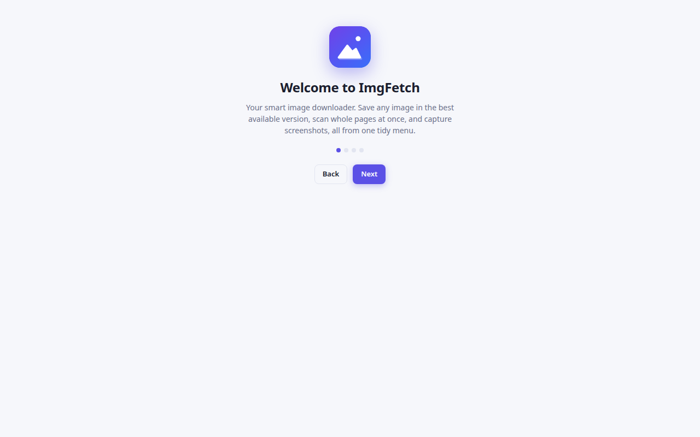
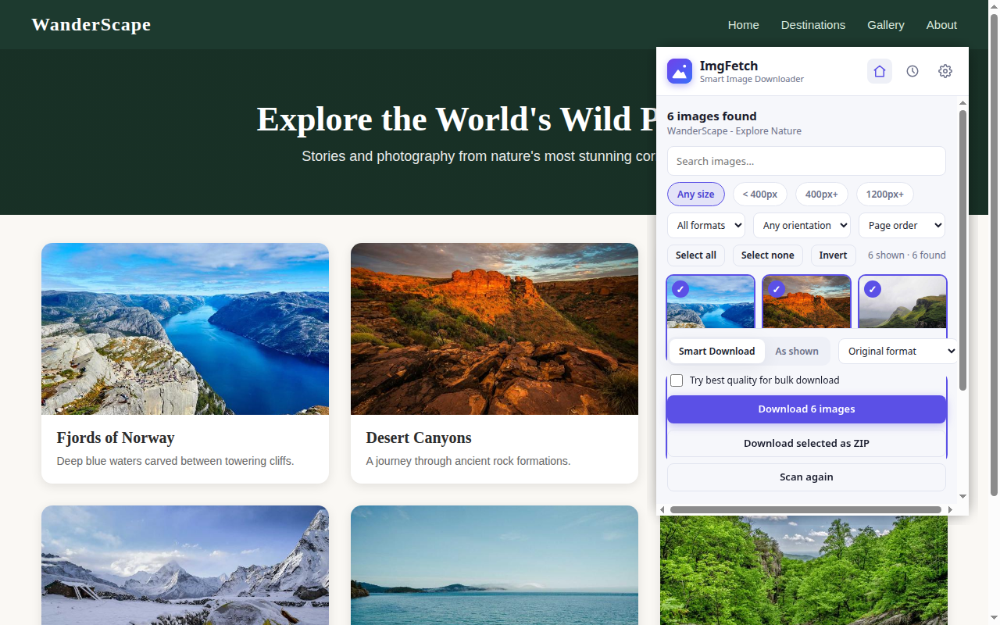
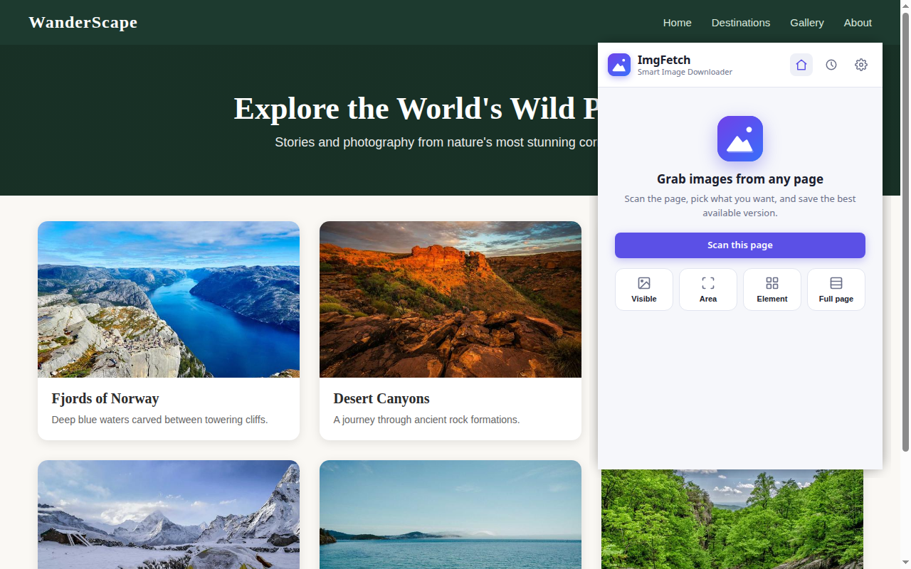
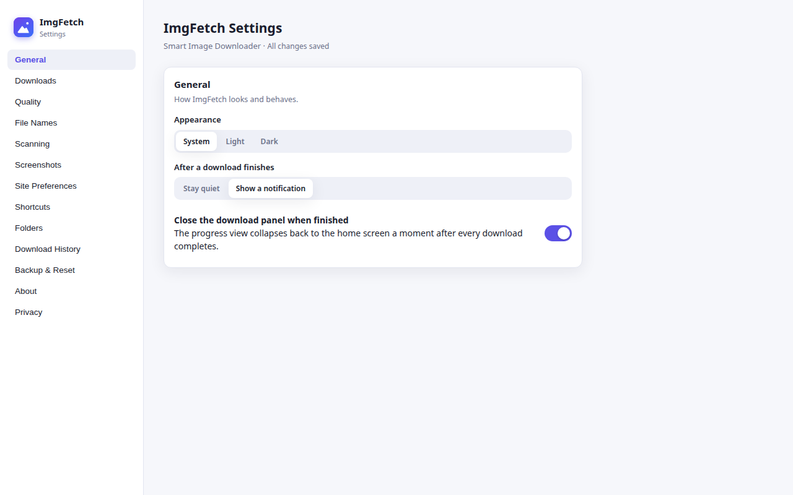
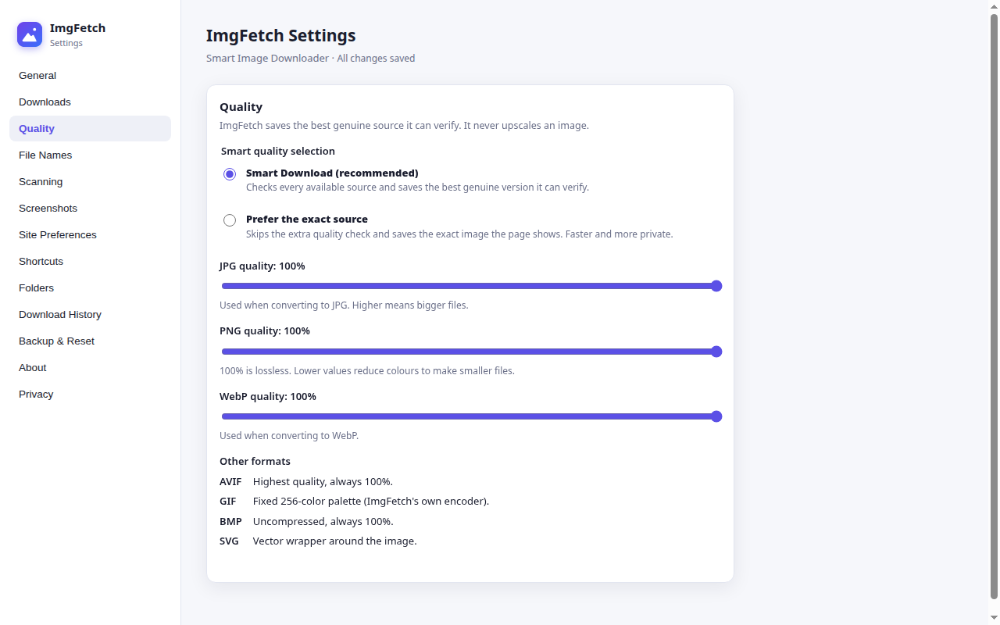

# ImgFetch

A free and open-source browser extension that saves images in their best genuinely available quality. No accounts, no analytics, no tracking.

## About

ImgFetch is a browser extension for Chrome, Edge and Firefox. Right-click any image and choose **Smart Download**: ImgFetch finds every real source (original, srcset, picture, lazy-loaded variants), verifies each one loads, and saves the best valid source. It never upscales and never invents quality.

Everything runs on your device. There are no accounts, no analytics, no telemetry and no tracking.

## Install

**From the stores** (recommended): links will be added here once the listings are live.

**Load unpacked** (developers):

1. Download the latest `imgfetch-1.0.0.zip` from [Releases](https://github.com/umr-x/ImgFetch/releases) and unzip it.
2. Open `chrome://extensions` (or `edge://extensions`), enable **Developer mode**.
3. Click **Load unpacked** and select the unzipped folder.

## Features

**Download**

- Smart Download: right-click any image to save its best validated quality.
- Save as: convert to PNG, JPEG, WebP, AVIF, GIF, SVG or BMP.
- Real PNG quality slider: 100% is lossless and pixel-identical; lower values reduce the colour count for smaller files.
- AVIF is offered when the browser supports encoding it.

**Scan This Page**

- Click the toolbar button to find every image on the page.
- Filter by size, format and orientation, preview, then download selected images or pack them into one ZIP.

**Screenshots**

- Capture the visible area, a selected area, the full page (stitched) or a single element.
- Built-in annotation editor before saving.

**Queue and history**

- Download queue with live per-file progress, retry and cancel.
- Download history records exact file sizes; it can be cleared or disabled.

**Customization**

- Per-site preferences, smart file names, folder organization.
- Keyboard shortcuts for Smart Download, Scan This Page and screenshots.
- One-click settings backup and restore.

## Screenshots

## Privacy

ImgFetch collects nothing. No accounts, no analytics, no telemetry, no tracking. Settings, history and preferences stay in your browser's local storage on your device. Full policy: [PRIVACY.md](PRIVACY.md).

## Keyboard shortcuts

The defaults are shown on the welcome page and can be changed at `chrome://extensions/shortcuts` (or `edge://extensions/shortcuts`):

- Smart Download
- Save as
- Scan This Page
- Screenshot: visible area
- Screenshot: full page

## Project structure

The full annotated file tree lives in [docs/PROJECT_STRUCTURE.md](docs/PROJECT_STRUCTURE.md). Short version:

- `background/` - service worker (message router, download orchestration)
- `content/` - page scanner and overlay injected into tabs
- `core/` - pure logic modules (no browser APIs): URLs, queue, ZIP, PNG, filenames, settings
- `offscreen/` - hidden document for canvas work (conversion, stitching, ZIP)
- `popup/`, `options/`, `pages/` - toolbar popup, settings page, editor and helper pages
- `shared/` - shared UI styles and components
- `tests/` - unit, contract, fuzz, race and end-to-end tests
- `scripts/` - build, validate and release tooling

## Contributing

Contributions are welcome. The full guide is in [CONTRIBUTING.md](CONTRIBUTING.md). The short version:

1. Open an issue first so the change is agreed before code exists.
2. Fork, branch from `main`, keep the change focused.
3. Run the test suite and `scripts/validate.py` before opening a PR.

## FAQ

**Is ImgFetch free?**
Yes. Free software under the GNU General Public License v3 or later, forever.

**Does it upload my images anywhere?**
No. Downloads and conversions happen on your device. The only network requests are the ones needed to fetch the images you chose to download.

**Why is AVIF sometimes unavailable?**
AVIF encoding depends on the browser. ImgFetch offers it only when the browser supports it; otherwise it shows a clear message and the fallback.

**How does Search with Google Lens work?**
It opens Google Lens with the image link ready. If the direct handoff is blocked, the link is copied to your clipboard so you can paste it.

## License

ImgFetch is free software: you can redistribute it and/or modify it under the terms of the GNU General Public License as published by the Free Software Foundation, either version 3 of the License, or (at your option) any later version. See [LICENSE](LICENSE) for the full text.
